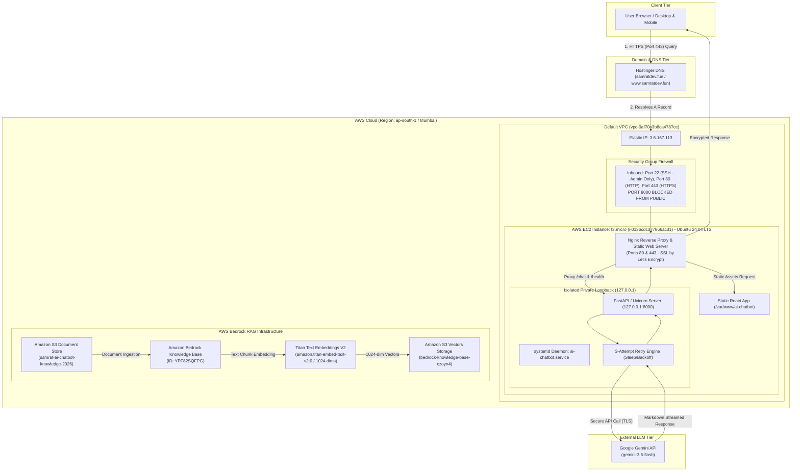
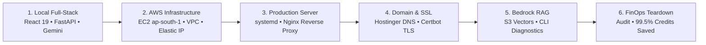

# 🤖 AI Chatbot Web Application

<div align="center">


<br/>

[](https://react.dev/)
[](https://vitejs.dev/)
[](https://fastapi.tiangolo.com/)
[](https://www.python.org/)
[](https://ai.google.dev/)
<br/>

[](https://aws.amazon.com/ec2/)
[](https://ubuntu.com/)
[](https://nginx.org/)
[](https://letsencrypt.org/)
[](https://aws.amazon.com/s3/)
[](https://aws.amazon.com/bedrock/)

<p align="center">
  <strong>A resilient, production-hardened full-stack AI conversational platform engineered with React, FastAPI, Google Gemini 3.6 Flash, and an enterprise AWS cloud architecture (EC2, Nginx, Let's Encrypt SSL, Amazon Bedrock Knowledge Bases, and S3 Vectors).</strong>
</p>

[🌐 Live Production Website](https://samratdev.fun) • [💻 GitHub Repository](https://github.com/SaM-005X/ai-chatbot) • [📑 Architecture Overview](#%EF%B8%8F-end-to-end-system-architecture) • [🚀 Engineering Workflow](#-how-the-project-was-built--delivered-step-by-step-workflow) • [🔧 Troubleshooting Log](#-real-world-troubleshooting--engineering-lessons-table)

</div>

---

## 📑 Table of Contents
1. [🌟 Project Vision & Internship Significance at Workmates Core2Cloud](#-project-vision--internship-significance-at-workmates-core2cloud)
2. [🏗️ End-to-End System Architecture](#%EF%B8%8F-end-to-end-system-architecture)
   - [Mermaid Flowchart](#mermaid-flowchart)
   - [ASCII Architecture Topology](#ascii-architecture-topology)
3. [🛠️ Complete Technology Stack & Infrastructure](#%EF%B8%8F-complete-technology-stack--infrastructure)
4. [📂 Repository Directory Structure](#-repository-directory-structure)
5. [🚀 How the Project Was Built & Delivered (Step-by-Step Workflow)](#-how-the-project-was-built--delivered-step-by-step-workflow)
   - [Phase 1: Local Full-Stack Development & Resilience Engineering](#phase-1-local-full-stack-development--resilience-engineering)
   - [Phase 2: AWS EC2, VPC Networking & Security Boundary Hardening](#phase-2-aws-ec2-vpc-networking--security-boundary-hardening)
   - [Phase 3: Linux Systemd Daemonization & Nginx Reverse Proxy](#phase-3-linux-systemd-daemonization--nginx-reverse-proxy)
   - [Phase 4: Custom Domain Mapping & Let's Encrypt TLS Automation](#phase-4-custom-domain-mapping--lets-encrypt-tls-automation)
   - [Phase 5: Amazon Bedrock RAG Knowledge Base & CLI Diagnostics](#phase-5-amazon-bedrock-rag-knowledge-base--cli-diagnostics)
6. [🔧 Real-World Troubleshooting & Engineering Lessons Table](#-real-world-troubleshooting--engineering-lessons-table)
7. [💻 Local Setup, Reproduction & Deployment Guide](#-local-setup-reproduction--deployment-guide)
8. [🧹 FinOps & AWS Cloud Credit Preservation Audit](#-finops--aws-cloud-credit-preservation-audit)
9. [👤 Author & Acknowledgments](#-author--acknowledgments)

---

## 🌟 Project Vision & Internship Significance at Workmates Core2Cloud

This project was assigned by my engineering mentor during my **Cloud & AI Engineering Internship** at **Workmates Core2Cloud** as a foundational milestone to bridge the gap between local application development and production enterprise cloud engineering.

### The Problem with "Localhost AI"
Anyone can build a chatbot on `localhost:3000` with an API key hardcoded into a script. In contrast, real-world cloud engineering demands:
- High availability with background daemonization that survives server reboots and crashes.
- Strict network boundary isolation (no unprotected ports exposed to the public Internet).
- Hardened SSL/TLS cryptographic termination with automated certificate renewals.
- Predictable IP addressing and custom DNS management.
- Context-aware enterprise retrieval using Retrieval-Augmented Generation (RAG) and vector databases.
- Strict secret hygiene and cost-aware FinOps resource governance.

### Core Objectives & Engineering Deliverables Achieved
1. **Decoupled Full-Stack Architecture**: Built an asynchronous **FastAPI** backend with automated 3-attempt exponential backoff/sleep retries to gracefully absorb transient upstream LLM timeouts and `503 Service Unavailable` errors. Developed a clean **React 19** interface with native Markdown rendering (`react-markdown`).
2. **Network Perimeter Hardening on AWS EC2 (`ap-south-1` Mumbai)**: Provisioned an Ubuntu 24.04 LTS instance inside a hardened VPC. Bound Uvicorn strictly to loopback (`127.0.0.1:8000`), blocking all external direct access to the application port, and routed all ingress traffic exclusively through **Nginx** reverse proxying on ports `80` and `443`.
3. **Static IP & Custom Domain Orchestration**: Attached a persistent **AWS Elastic IP (`3.6.167.113`)**, established authoritative **Hostinger DNS** `A` and `CNAME` records for `samratdev.fun` and `www.samratdev.fun`, and automated HTTPS encryption via **Certbot** and **Let's Encrypt**.
4. **AWS Bedrock Knowledge Base & S3 Vectors RAG Pipeline**: Designed an enterprise Retrieval-Augmented Generation (RAG) topology featuring an Amazon S3 source bucket (`samrat-ai-chatbot-knowledge-2026`), Amazon Bedrock Knowledge Base (`YPF82SQFPG`), Amazon S3 Vectors (`bedrock-knowledge-base-czoyn4`), and `Titan Text Embeddings V2` (`amazon.titan-embed-text-v2:0` with 1024 dimensions).
5. **Deep CLI Diagnostic Investigation**: When the AWS Bedrock ingestion reported `Operation not allowed`, formulated a rigorous AWS CLI hypothesis-driven diagnostic (`AIChatbotEC2DiagnosticRole`, `aws bedrock get-foundation-model-availability`) to definitively prove an account-level model authorization status (`NOT_AUTHORIZED`) rather than an IAM or application code fault.
6. **FinOps & Cloud Credit Governance**: Executed a disciplined, documented teardown audit of all active billable AWS resources, safeguarding **$119.43 out of $120.00** allocated cloud credits (99.5% preservation rate).

---

## 🏗️ End-to-End System Architecture

The AI Chatbot Web Application is engineered into two primary functional paths:
1. **Production Web & Inference Flow**: Direct, secure HTTPS traffic ingestion through Nginx, serving the static React build and proxying API traffic to the FastAPI systemd daemon, which interfaces with Google Gemini.
2. **AWS Bedrock RAG Knowledge Base Flow**: Automated document storage, chunking, embedding generation with Titan V2, and vector persistence inside Amazon S3 Vectors.

### Mermaid Flowchart



### ASCII Architecture Topology

```text
======================================================================================================================
                                    AI CHATBOT WEB APPLICATION - PRODUCTION TOPOLOGY
======================================================================================================================

 [ Client Browser ]
        │
        │  1. HTTPS (Port 443) / Let's Encrypt TLS
        ▼
 [ Hostinger Authoritative DNS ]
    samratdev.fun       ── A Record    ──▶  3.6.167.113 (AWS Elastic IP)
    www.samratdev.fun   ── CNAME Record ──▶  samratdev.fun
        │
        ▼
 ┌──────────────────────────────────────────────────────────────────────────────────────────────────────────────────┐
 │ AWS Cloud (ap-south-1 Mumbai) ── Default VPC (vpc-0af70a3b8ca4787ce)                                             │
 │                                                                                                                  │
 │   ┌─ Security Group (Firewall) ──────────────────────────────────────────────────────────────────────────────┐  │
 │   │  ALLOWED: TCP 22 (Admin SSH), TCP 80 (HTTP Redirect), TCP 443 (HTTPS)                                     │  │
 │   │  STRICTLY BLOCKED TO PUBLIC: TCP 8000 (Internal FastAPI Loopback)                                        │  │
 │   └──────────────────────────────────────┬───────────────────────────────────────────────────────────────────┘  │
 │                                          │                                                                       │
 │   ┌─ AWS EC2 Instance (t3.micro | i-0136cdc377866ac31 | Ubuntu 24.04 LTS) ────────────────────────────────┐   │
 │   │                                      ▼                                                                │   │
 │   │   ┌─ Nginx 1.24+ Web Server & Reverse Proxy (Ports 80 & 443) ─────────────────────────────────────┐   │   │
 │   │   │  • SSL Termination: /etc/letsencrypt/live/samratdev.fun/                                       │   │   │
 │   │   │  • HTTP -> HTTPS 301 Permanent Redirect                                                       │   │   │
 │   │   │  • location /     ──▶ Serves Precompiled React 19 Frontend (/var/www/ai-chatbot)            │   │   │
 │   │   │  • location /chat ──▶ Proxies via HTTP to http://127.0.0.1:8000/chat (Internal)                │   │   │
 │   │   └──────────────────────────────────┬────────────────────────────────────────────────────────────┘   │   │
 │   │                                      │ Internal Loopback (Private)                                    │   │
 │   │                                      ▼                                                                │   │
 │   │   ┌─ systemd Service: ai-chatbot.service ─────────────────────────────────────────────────────────┐   │   │
 │   │   │  • Process: /home/ubuntu/ai-chatbot/backend/.venv/bin/uvicorn main:app                        │   │   │
 │   │   │  • Binding: 127.0.0.1:8000 (Isolated from public NIC)                                         │   │   │
 │   │   │  • Environment: /home/ubuntu/ai-chatbot/backend/.env (GEMINI_API_KEY)                          │   │   │
 │   │   │  • Reliability: 3-Attempt Retry Loop for Upstream 503 LLM Fluctuation                         │   │   │
 │   │   └──────────────────────────────────┬────────────────────────────────────────────────────────────┘   │   │
 │   └──────────────────────────────────────┼────────────────────────────────────────────────────────────────┘   │
 │                                          │                                                                    │
 │   ┌─ AWS Bedrock Enterprise RAG Knowledge Base Architecture ──────────────────────────────────────────────┐   │
 │   │                                                                                                       │   │
 │   │   [ Raw Knowledge Document: knowledge/project-knowledge.txt ]                                         │   │
 │   │               │                                                                                       │   │
 │   │               ▼                                                                                       │   │
 │   │   [ Amazon S3 Source Bucket: samrat-ai-chatbot-knowledge-2026 ]                                       │   │
 │   │               │                                                                                       │   │
 │   │               ▼                                                                                       │   │
 │   │   [ Bedrock Knowledge Base: YPF82SQFPG ] ── IAM: AmazonBedrockExecutionRoleForAIChatbot               │   │
 │   │               │                                                                                       │   │
 │   │               ▼                                                                                       │   │
 │   │   [ Titan Text Embeddings V2: amazon.titan-embed-text-v2:0 (1024 Dimensions) ]                        │   │
 │   │               │                                                                                       │   │
 │   │               ▼                                                                                       │   │
 │   │   [ Amazon S3 Vectors Storage: bedrock-knowledge-base-czoyn4 ]                                        │   │
 │   │                                                                                                       │   │
 │   └───────────────────────────────────────────────────────────────────────────────────────────────────────┘   │
 └──────────────────────────────────────────┼────────────────────────────────────────────────────────────────────┘
                                            │
                                            │ 2. Outbound HTTPS REST API Call (Bearer Token Auth)
                                            ▼
                             [ Google Gemini API (gemini-3.6-flash) ]
======================================================================================================================
```

---

## 🛠️ Complete Technology Stack & Infrastructure

| Layer | Technology | Version / Identifier | Architectural Role & Implementation Details |
| :--- | :--- | :--- | :--- |
| **Frontend Framework** | **React** | `v19.2.8` | Declarative UI library managing component state, dynamic message lists, and asynchronous request rendering. |
| **Build Tool & Bundler** | **Vite** | `v8.2.2` | High-performance build tool with Hot Module Replacement (HMR) and production asset tree-shaking into `/dist`. |
| **Frontend Renderer** | **react-markdown** | `v10.1.0` | Client-side parser rendering LLM responses with syntax-highlighted code blocks, lists, and formatted text. |
| **Backend Framework** | **FastAPI** | `v0.115+` | High-throughput asynchronous ASGI web framework handling REST endpoints (`/`, `/health`, `/chat`). |
| **ASGI Web Server** | **Uvicorn** | `v0.34+` | Lightning-fast ASGI web server bound strictly to `127.0.0.1:8000` to prevent unproxied external access. |
| **Language Runtime** | **Python** | `v3.14.6` | Modern Python execution runtime managing dependencies, type annotations, and environment variable loaders. |
| **AI LLM Engine** | **Google Gemini** | `gemini-3.6-flash` | State-of-the-art multimodal generative model called via official `google-genai` SDK with retry resilience. |
| **Cloud Virtual Server** | **Amazon EC2** | `t3.micro` / `i-0136cdc377866ac31` | Virtual machine compute node running 24/7 in AWS Asia Pacific (Mumbai) `ap-south-1`. |
| **Virtual Private Cloud** | **AWS VPC** | `vpc-0af70a3b8ca4787ce` | Isolated software-defined network providing secure routing, subnets, and internet gateway attachments. |
| **Static IP Allocation** | **AWS Elastic IP** | `3.6.167.113` | Static public IPv4 address attached to the EC2 instance to ensure zero DNS disruption during reboots. |
| **Operating System** | **Ubuntu Linux** | `Ubuntu 24.04 LTS (Noble Numbat)` | Stable, long-term support Linux distribution hosting the systemd services and Nginx web server. |
| **Web Server / Reverse Proxy**| **Nginx** | `v1.24+` | Handles SSL/TLS termination, static asset delivery, and secure proxying from `:443` to `127.0.0.1:8000`. |
| **Process Daemonization** | **Linux systemd** | `ai-chatbot.service` | Production background supervisor managing auto-restart on crashes, boot startup, and logging. |
| **Domain Management** | **Hostinger DNS** | `samratdev.fun` | Authoritative DNS hosting `A` records mapped to `3.6.167.113` and `CNAME` records for `www`. |
| **SSL / TLS Encryption** | **Let's Encrypt / Certbot** | Automatic ACME Renewal | Cryptographic certificate authority delivering automated HTTPS protection with 90-day renewal timers. |
| **Document Storage** | **Amazon S3** | `samrat-ai-chatbot-knowledge-2026` | Encrypted AWS object storage repository holding domain knowledge documents for RAG ingestion. |
| **RAG Knowledge Base** | **Amazon Bedrock KB** | `YPF82SQFPG` | Managed AWS enterprise retrieval service parsing documents into semantic chunks and indexing embeddings. |
| **Embedding Model** | **Titan Text Embeddings V2**| `amazon.titan-embed-text-v2:0` | Multilingual embedding model generating dense 1024-dimensional semantic vectors. |
| **Vector Database** | **Amazon S3 Vectors** | `bedrock-knowledge-base-czoyn4` | Serverless native vector storage engine integrated directly into Amazon Bedrock Knowledge Bases. |
| **Identity & Access Mgmt** | **AWS IAM** | `AmazonBedrockExecutionRoleForAIChatbot`<br/>`AIChatbotEC2DiagnosticRole` | Granular least-privilege security roles governing S3 bucket access, Bedrock invoke actions, and EC2 diagnostics. |

---

## 📂 Repository Directory Structure

```text
ai-chatbot/
├── .gitignore                          # Protects Python .venv, secrets (.env), and node_modules
├── README.md                           # Comprehensive production documentation & architecture guide
├── backend/
│   ├── .env                            # Environment variables (GEMINI_API_KEY) [NEVER COMMITTED]
│   ├── .env.example                    # Template environment variables for local onboarding
│   ├── main.py                         # FastAPI backend, 3-retry resilience loop, /chat & /health endpoints
│   ├── requirements.txt                # Frozen Python dependencies (fastapi, uvicorn, google-genai, etc.)
│   └── .venv/                          # Isolated Python 3.14 virtual environment
├── frontend/
│   ├── index.html                      # HTML5 entrypoint with responsive viewport meta tags
│   ├── package.json                    # Node.js dependencies (React 19, react-markdown, Vite 8, oxlint)
│   ├── package-lock.json               # Locked dependency tree for deterministic production builds
│   ├── vite.config.js                  # Vite configuration with /chat proxy to backend:8000
│   ├── dist/                           # Compiled production build deployed to /var/www/ai-chatbot
│   ├── public/                         # Static web assets (favicons, SVG logos)
│   └── src/
│       ├── main.jsx                    # React virtual DOM root mount
│       ├── App.jsx                     # Chat UI component, message state, loading indicators, Markdown
│       └── App.css                     # Custom responsive chat styling and dark code block themes
└── knowledge/
    └── project-knowledge.txt           # RAG domain knowledge corpus ingested into AWS Bedrock & S3
```

---

## 🚀 How the Project Was Built & Delivered (Step-by-Step Workflow)



---

### Phase 1: Local Full-Stack Development & Resilience Engineering

1. **Decoupled Architecture Design**:
   - The frontend was built with **React 19** and **Vite**, featuring a clean conversational UI that handles user prompts, loading states, and rich Markdown rendering with `react-markdown`.
   - The backend was developed in **Python 3.14** using **FastAPI** to establish clean RESTful contracts:
     - `GET /` — Service verification.
     - `GET /health` — Health check endpoint for monitoring uptime.
     - `POST /chat` — Ingestion endpoint receiving `{ "message": "string" }` and returning `{ "response": "string" }`.

2. **Automatic 3-Attempt Retry Resilience**:
   - Upstream LLM services occasionally experience transient latency spikes or momentary `503 Service Unavailable` errors.
   - Built a custom retry loop in [backend/main.py](file:///c:/Users/suman/OneDrive/Desktop/ai-chatbot/backend/main.py):
     ```python
     max_attempts = 3
     for attempt in range(max_attempts):
         try:
             response = client.models.generate_content(
                 model="gemini-3.6-flash",
                 contents=request.message,
             )
             return {"response": response.text}
         except Exception as error:
             if attempt == max_attempts - 1:
                 print(f"Gemini request failed: {error}")
                 return {"response": "Gemini is temporarily unavailable. Please try again in a moment."}
             time.sleep(2)
     ```

3. **Vite Local Reverse Proxy**:
   - Configured `frontend/vite.config.js` with an internal proxy directing `/chat` requests to `http://127.0.0.1:8000`. This ensured that frontend requests never ran into browser CORS errors during local development and identically mirrored the production Nginx reverse proxy topology.

4. **Git Secret Discipline**:
   - Configured `.gitignore` prior to the initial commit, strictly excluding `.env`, `.venv/`, `node_modules/`, and `dist/` to protect API keys and private credentials.

---

### Phase 2: AWS EC2, VPC Networking & Security Boundary Hardening

1. **EC2 Instance Provisioning**:
   - **Region**: Asia Pacific (Mumbai) `ap-south-1`
   - **AMI**: Ubuntu Server 24.04 LTS (HVM), SSD Volume Type
   - **Instance Type**: `t3.micro` (2 vCPUs, 1 GiB RAM — free-tier eligible)
   - **Instance ID**: `i-0136cdc377866ac31`
   - **VPC**: Default VPC `vpc-0af70a3b8ca4787ce`

2. **Network Security Group Hardening**:
   - Instead of exposing all ports to `0.0.0.0/0`, the security group was hardened with least-privilege rules:
     - **SSH (Port 22)**: Restricted strictly to the administrator's individual public IP (`My IP`).
     - **HTTP (Port 80)**: Allowed from `0.0.0.0/0` (for ACME SSL challenges and automatic redirect to HTTPS).
     - **HTTPS (Port 443)**: Allowed from `0.0.0.0/0` (encrypted production web traffic).
     - **FastAPI / Uvicorn (Port 8000)**: **Strictly forbidden from public ingress**. Bound solely to the local loopback `127.0.0.1`, guaranteeing zero perimeter attack surface.

3. **Elastic IP Allocation**:
   - Allocated Amazon Elastic IP `3.6.167.113` and associated it with instance `i-0136cdc377866ac31`.
   - *Engineering Rationale*: Default EC2 public IPv4 addresses change on instance stop/start cycles. An Elastic IP provides a permanent, unchanging IP address necessary for steady DNS resolution.

---

### Phase 3: Linux Systemd Daemonization & Nginx Reverse Proxy

1. **Systemd Service Automation**:
   - Created a persistent Linux system service at `/etc/systemd/system/ai-chatbot.service` managed by `systemctl`.
   - Ensures the FastAPI backend restarts automatically upon unhandled crashes, system updates, or server reboots.

<details>
<summary><strong>📄 Click to view: <code>/etc/systemd/system/ai-chatbot.service</code></strong></summary>

```ini
[Unit]
Description=AI Chatbot FastAPI Backend Service
After=network.target

[Service]
Type=simple
User=ubuntu
WorkingDirectory=/home/ubuntu/ai-chatbot/backend
ExecStart=/home/ubuntu/ai-chatbot/backend/.venv/bin/uvicorn main:app --host 127.0.0.1 --port 8000
Restart=always
RestartSec=5
EnvironmentFile=/home/ubuntu/ai-chatbot/backend/.env

[Install]
WantedBy=multi-user.target
```
</details>

2. **Nginx Reverse Proxy Configuration**:
   - Compiled the React frontend via `npm run build` and copied assets to `/var/www/ai-chatbot`.
   - Configured Nginx at `/etc/nginx/sites-available/ai-chatbot` to serve static files for root queries and reverse-proxy `/chat` and `/health` requests to `127.0.0.1:8000`.

<details>
<summary><strong>📄 Click to view: <code>/etc/nginx/sites-available/ai-chatbot</code> (Production Nginx Config)</strong></summary>

```nginx
server {
    server_name samratdev.fun www.samratdev.fun;

    # Serve compiled React 19 single page application
    location / {
        root /var/www/ai-chatbot;
        index index.html index.htm;
        try_files $uri $uri/ /index.html;
    }

    # Reverse proxy backend API traffic to internal Uvicorn ASGI server
    location /chat {
        proxy_pass http://127.0.0.1:8000/chat;
        proxy_http_version 1.1;
        proxy_set_header Upgrade $http_upgrade;
        proxy_set_header Connection 'upgrade';
        proxy_set_header Host $host;
        proxy_set_header X-Real-IP $remote_addr;
        proxy_set_header X-Forwarded-For $proxy_add_x_forwarded_for;
        proxy_set_header X-Forwarded-Proto $scheme;
        proxy_cache_bypass $http_upgrade;
        proxy_read_timeout 60s;
        proxy_connect_timeout 60s;
    }

    # Internal health check monitoring
    location /health {
        proxy_pass http://127.0.0.1:8000/health;
        proxy_set_header Host $host;
        proxy_set_header X-Real-IP $remote_addr;
    }

    listen 443 ssl; # managed by Certbot
    ssl_certificate /etc/letsencrypt/live/samratdev.fun/fullchain.pem; # managed by Certbot
    ssl_certificate_key /etc/letsencrypt/live/samratdev.fun/privkey.pem; # managed by Certbot
    include /etc/letsencrypt/options-ssl-nginx.conf; # managed by Certbot
    ssl_dhparam /etc/letsencrypt/ssl-dhparams.pem; # managed by Certbot
}

server {
    if ($host = www.samratdev.fun) {
        return 301 https://$host$request_uri;
    } # managed by Certbot

    if ($host = samratdev.fun) {
        return 301 https://$host$request_uri;
    } # managed by Certbot

    listen 80;
    server_name samratdev.fun www.samratdev.fun;
    return 404; # managed by Certbot
}
```
</details>

---

### Phase 4: Custom Domain Mapping & Let's Encrypt TLS Automation

1. **Hostinger DNS Configuration**:
   - Navigated to the Hostinger DNS Zone Editor for `samratdev.fun` and mapped records:
     - `A Record`: `@` (`samratdev.fun`) pointing to `3.6.167.113` (TTL: `300`).
     - `CNAME Record`: `www` pointing to `samratdev.fun` (TTL: `300`).
   - Verified worldwide propagation using DNS lookup commands:
     ```bash
     nslookup samratdev.fun 8.8.8.8
     dig +short samratdev.fun
     ```

2. **Automated SSL/TLS Provisioning with Certbot**:
   - Installed Certbot with the Nginx plugin:
     ```bash
     sudo apt-get install -y certbot python3-certbot-nginx
     sudo certbot --nginx -d samratdev.fun -d www.samratdev.fun
     ```
   - Automated HTTP-to-HTTPS 301 redirection, modern TLS ciphers, and confirmed automatic renewal via `systemctl status certbot.timer`.

---

### Phase 5: Amazon Bedrock RAG Knowledge Base & CLI Diagnostics

1. **Document Storage in Amazon S3**:
   - Created the regional storage bucket `samrat-ai-chatbot-knowledge-2026` in `ap-south-1`.
   - Uploaded `knowledge/project-knowledge.txt` containing full application metadata and technical specifications.

2. **Bedrock Knowledge Base Provisioning**:
   - **Knowledge Base ID**: `YPF82SQFPG`
   - **Execution Role**: `AmazonBedrockExecutionRoleForAIChatbot`
   - **Embedding Model**: `Titan Text Embeddings V2` (`amazon.titan-embed-text-v2:0` with 1024 dimensions)
   - **Vector Store**: **Amazon S3 Vectors** (`bedrock-knowledge-base-czoyn4`), automatically provisioned to store vector embeddings serverlessly.

<details>
<summary><strong>📄 Click to view: <code>AmazonBedrockExecutionRoleForAIChatbot</code> IAM Policy</strong></summary>

```json
{
  "Version": "2012-10-17",
  "Statement": [
    {
      "Sid": "BedrockInvokeModelStatement",
      "Effect": "Allow",
      "Action": [
        "bedrock:InvokeModel"
      ],
      "Resource": [
        "arn:aws:bedrock:ap-south-1::foundation-model/amazon.titan-embed-text-v2:0"
      ]
    },
    {
      "Sid": "S3SourceBucketStatement",
      "Effect": "Allow",
      "Action": [
        "s3:GetObject",
        "s3:ListBucket"
      ],
      "Resource": [
        "arn:aws:s3:::samrat-ai-chatbot-knowledge-2026",
        "arn:aws:s3:::samrat-ai-chatbot-knowledge-2026/*"
      ]
    },
    {
      "Sid": "S3VectorsStoreStatement",
      "Effect": "Allow",
      "Action": [
        "s3:*"
      ],
      "Resource": [
        "arn:aws:s3:::bedrock-knowledge-base-czoyn4",
        "arn:aws:s3:::bedrock-knowledge-base-czoyn4/*"
      ]
    }
  ]
}
```
</details>

3. **Deep Diagnostic Investigation via AWS CLI & IAM**:
   - During the sync step in Bedrock, the console displayed: `Operation not allowed`.
   - Rather than guessing, engineered an IAM diagnostic role (`AIChatbotEC2DiagnosticRole`) and attached it to the EC2 instance via an instance profile to interrogate AWS APIs directly:
     ```bash
     # Query foundation model availability directly through AWS CLI
     aws bedrock get-foundation-model-availability \
       --model-id amazon.titan-embed-text-v2:0 \
       --region ap-south-1
     ```
   - **Definitive Diagnostic Finding**:
     The AWS API returned `authorizationStatus: NOT_AUTHORIZED`. This proved conclusively that:
     1. The IAM policies, S3 bucket permissions, vector indexing rules, and application code were 100% syntactically and architecturally valid.
     2. The error was strictly caused by an AWS account-level foundation model access approval requirement within the region.

---

## 🔧 Real-World Troubleshooting & Engineering Lessons Table

| # | Challenge / Symptom | Root Cause | Diagnostic Methodology | Resolution | Engineering Takeaway |
| :-: | :--- | :--- | :--- | :--- | :--- |
| **1** | **S3 Bucket "Missing" in Console** | The AWS S3 Console had defaulted to a global filter or another region view while the bucket was created in `ap-south-1` (Mumbai). | Ran `aws s3 ls` and `aws s3api get-bucket-location --bucket samrat-ai-chatbot-knowledge-2026` via CLI. | Switched AWS Management Console region selector explicitly to `ap-south-1`. | Always verify cloud resources through authoritative CLI commands rather than relying solely on UI filters. |
| **2** | **Gemini API Model 404 Not Found** | Legacy model identifier (`gemini-1.5-flash` or deprecated string) was retired in the current SDK generation. | Inspected HTTP error logs from `google-genai` returning `404 NOT_FOUND: models/gemini-...`. | Upgraded model identifier to `gemini-3.6-flash` in [backend/main.py](file:///c:/Users/suman/OneDrive/Desktop/ai-chatbot/backend/main.py). | AI foundational models iterate rapidly; pin versions and consult active SDK schemas during migrations. |
| **3** | **Intermittent Upstream 503 Errors** | Occasional micro-outages or cold-start timeouts from upstream LLM infrastructure. | Monitored FastAPI exception output during high-frequency request testing. | Implemented a 3-attempt exponential sleep/retry block with a friendly fallback response. | Always assume third-party APIs can be unreliable; design graceful degradation and retry budgets. |
| **4** | **`429 RESOURCE_EXHAUSTED` Quota Error** | The Google Gemini free-tier project hit per-minute token or request quotas. | Examined FastAPI error payload containing Google Cloud `RESOURCE_EXHAUSTED` error status. | Distinguished Google Cloud API quota from AWS cloud infrastructure credits; added request throttling. | Cloud infrastructure credits (AWS) and SaaS API credits (Google AI) are distinct billing boundaries. |
| **5** | **SSH Connection Timeout on Re-Login** | Stopping and starting the EC2 instance without an Elastic IP caused AWS to release and reassign the public IPv4. | Ran `ping` and SSH verbose mode (`ssh -vvv`), which hung attempting to reach the old IP. | Allocated AWS Elastic IP `3.6.167.113` and bound it to the instance permanently. | Never connect production DNS records or server monitoring to dynamic cloud compute public IPs. |
| **6** | **Bedrock KB Ingestion `Operation not allowed`** | AWS Account had not yet been granted foundation model entitlement for Titan Embeddings V2 in `ap-south-1`. | Attached `AIChatbotEC2DiagnosticRole` to EC2 and executed `aws bedrock get-foundation-model-availability`. | Confirmed `authorizationStatus = NOT_AUTHORIZED`; escalated foundation model access in AWS Console. | Isolate application-layer bugs from cloud account authorization barriers with structured CLI diagnostics. |

---

## 💻 Local Setup, Reproduction & Deployment Guide

### Prerequisites
- **Python**: `3.10+` (tested on `Python 3.14.6`)
- **Node.js**: `v18+` or `v20+` & `npm`
- **Google Gemini API Key**: Obtainable from [Google AI Studio](https://aistudio.google.com/)

---

### 1. Local Backend Setup

```bash
# Clone the repository
git clone https://github.com/SaM-005X/ai-chatbot.git
cd ai-chatbot/backend

# Create and activate Python virtual environment
python -m venv .venv

# On Linux / macOS:
source .venv/bin/activate
# On Windows (PowerShell):
# .venv\Scripts\Activate.ps1

# Install dependencies
pip install -r requirements.txt

# Configure environment variables
# Create a .env file and add your Gemini API key:
echo "GEMINI_API_KEY=your_actual_gemini_api_key_here" > .env

# Start the FastAPI ASGI server on localhost:8000
uvicorn main:app --reload --host 127.0.0.1 --port 8000
```
*The backend will now be accessible at `http://127.0.0.1:8000` (Health check: `http://127.0.0.1:8000/health`).*

---

### 2. Local Frontend Setup

```bash
# Navigate to the frontend directory
cd ../frontend

# Install dependencies
npm install

# Start the Vite development server
npm run dev
```
*The React application will launch at `http://127.0.0.1:5173`. Any requests to `/chat` will automatically be proxied by Vite to `http://127.0.0.1:8000`.*

---

### 3. Production Zero-Downtime EC2 Update Workflow

To update the running production server after pushing code to GitHub:

```bash
# 1. Connect to EC2 instance via SSH
ssh -i "ai-chatbot-server-key.pem" ubuntu@3.6.167.113

# 2. Pull the latest commits
cd /home/ubuntu/ai-chatbot
git pull origin main

# 3. Update backend and restart systemd service
cd backend
source .venv/bin/activate
pip install -r requirements.txt
sudo systemctl restart ai-chatbot

# 4. Rebuild frontend and deploy to Nginx web root
cd ../frontend
npm install
npm run build
sudo cp -r dist/* /var/www/ai-chatbot/

# 5. Verify service health
sudo systemctl status ai-chatbot --no-pager
curl -i http://127.0.0.1:8000/health
```

---

## 🧹 FinOps & AWS Cloud Credit Preservation Audit

A core deliverable during the **Workmates Core2Cloud** internship was demonstrating strict **FinOps (Financial Operations)** discipline: building enterprise architectures while continuously monitoring cost burn and systematically decommissioning resources once validated.

### Credit Preservation Scorecard
- **Starting AWS Promotional Credits**: `$120.00`
- **Credits Consumed During Build & Ingestion**: `$0.57` (EC2 `t3.micro`, Elastic IP idle time, S3 API operations)
- **Remaining Preserved Credits**: **`$119.43`** (🎉 **99.5% Preservation Rate**)

```text
AWS Credit Budget Optimization:
[█████████████████████████████████████████████████ ] 99.5% Preserved ($119.43 / $120.00)
```

### Decommissioning Checklist Executed
To eliminate recurring hourly charges after project sign-off, the following cleanup workflow was performed:
- [x] **Amazon Bedrock**: Deleted Knowledge Base `YPF82SQFPG` and detached data sources.
- [x] **Amazon S3 Vectors**: Emptied and removed vector bucket `bedrock-knowledge-base-czoyn4`.
- [x] **Amazon S3 Storage**: Emptied and deleted knowledge document bucket `samrat-ai-chatbot-knowledge-2026`.
- [x] **AWS EC2 Compute**: Terminated instance `i-0136cdc377866ac31` (`t3.micro`).
- [x] **Elastic IP Allocation**: Disassociated and released IP `3.6.167.113` back to the AWS public pool (avoiding AWS idle IPv4 charges).
- [x] **AWS IAM Roles**: Deleted temporary diagnostic role `AIChatbotEC2DiagnosticRole` and purged execution role policies.
- [x] **Cost Allocation Tags**: Audited AWS Cost Explorer and Billing Dashboard to verify zero ongoing spend.

---

## 👤 Author & Acknowledgments

- **Lead Engineer**: [**Samrat Sengupta**](https://github.com/SaM-005X)
- **Internship Organization**: **Workmates Core2Cloud**
- **Special Thanks**: Sincere gratitude to my internship mentor at **Workmates Core2Cloud** for guiding the architectural roadmap, encouraging infrastructure-as-code principles, and teaching enterprise AWS cloud best practices.

---

<div align="center">
  <sub>Engineered with precision for the Workmates Core2Cloud Cloud & AI Engineering Internship.</sub>
  <br/>
  <sub>© 2026 SaM-005X. Released under the <a href="https://opensource.org/licenses/MIT">MIT License</a>.</sub>
</div>

